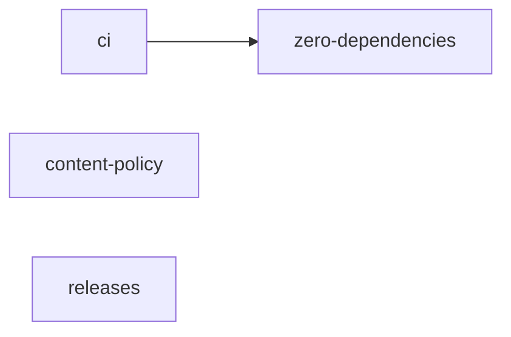

# CI, contributor rules and the release workflow

This change gets the repo ready for outside contributors and for publishing.

- **Tests on GitHub:** every push and pull request runs the tests on Node 20.19, 22 and 24, plus Windows.
- **Contributor rules:** contributors get a written content policy, a sign-off requirement and an issue form for suggesting excuses without code.
- **Publishing:** a GitHub release publishes to npm through trusted publishing, so no npm token is stored anywhere.

## Reading order

1. `.github/workflows/test.yml` and `.github/dependabot.yml`
2. `CONTRIBUTING.md`, `CODE_OF_CONDUCT.md`, `SECURITY.md`
3. `.github/ISSUE_TEMPLATE/` (blank issues off) and `.github/pull_request_template.md`
4. `test/library.test.js`: the new check for hidden format characters in excuses
5. `README.md` (the CONTRIBUTING link)
6. `.github/workflows/publish.yml`

## Notes

- [ci.md](../../knowledge/ci.md): what CI runs and why.
- [content-policy.md](../../knowledge/content-policy.md): what never gets merged, and why it's written down.
- [releases.md](../../knowledge/releases.md): trusted publishing, the manual first publish, and semver.

## Pushes

1. 2026-11-03: "Run the tests in CI on every push and pull request", "Add the contributor guide, content policy and issue forms", "Publish to npm from GitHub releases" and this hub.
2. 2026-11-03: "Tighten the public wording before launch". Changed content-policy.md.
3. 2026-11-04: "Set the version to 1.0.0". No notes changed.
