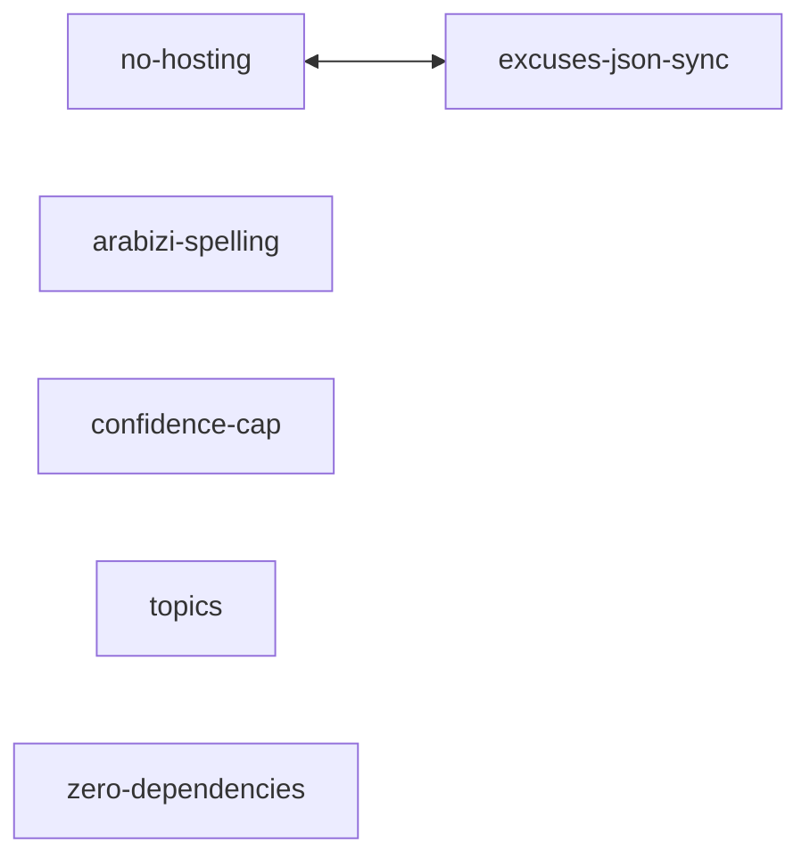

# First version: the excuse library and the CLI

ma3lesh is a zero-dependency npm package of Jordanian excuses for three questions:

- **when** will it be done
- **where** are you
- **why** isn't it done

Each excuse comes with what it really means, in English, Ammani Arabic or Arabizi. There's no server: the package, its CLI and a generated `excuses.json` are the whole product. The owner proofread all of the Arabic and Arabizi.

## Reading order

1. `src/excuses.js`: 40 excuses grouped by topic, each with `says` and `means` in three scripts.
2. `src/index.js`: `excuse()`, `normalizeLang()`, `normalizeTopic()` and the frozen exports.
3. `test/library.test.js`: data shape, script checks, topics, JSON sync and hostile inputs.
4. `scripts/build-json.js` and `excuses.json`.
5. `bin/ma3lesh.js` and `test/cli.test.js`: the CLI, its topic menu and `--ask`.
6. `README.md` and `package.json`.

## Notes

- [no-hosting.md](../../knowledge/no-hosting.md): why it's a package and not a service.
- [excuses-json-sync.md](../../knowledge/excuses-json-sync.md): why the JSON is generated, committed and tested.
- [arabizi-spelling.md](../../knowledge/arabizi-spelling.md): the one Arabizi convention, including the owner's article rules.
- [confidence-cap.md](../../knowledge/confidence-cap.md): why confidence stops at 19%.
- [topics.md](../../knowledge/topics.md): why there are three topics and how the CLI menu behaves.
- [zero-dependencies.md](../../knowledge/zero-dependencies.md): why the CLI parses its own arguments.

## Pushes

1. 2026-11-03: "Add the excuse data and the excuse library", "Add the ma3lesh CLI" and this hub.
2. 2026-11-03: "Tighten the public wording before launch". Changed topics.md.
